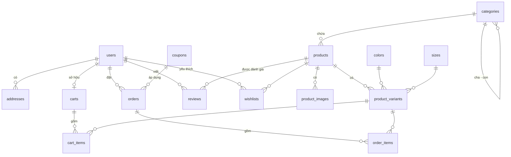

# 02 — Thiết kế cơ sở dữ liệu (PostgreSQL)

Hệ quản trị: **PostgreSQL (Neon)**. Script tạo bảng: `scripts/001_create_schema.sql`.

## 1. Sơ đồ quan hệ (ERD)

## 2. Mô tả các bảng

### users — Người dùng
| Cột | Kiểu | Ràng buộc | Ghi chú |
|---|---|---|---|
| id | UUID | PK | |
| email | VARCHAR(255) | UNIQUE, NOT NULL | |
| password_hash | TEXT | NOT NULL | Mật khẩu đã băm |
| full_name | VARCHAR(120) | NOT NULL | |
| phone | VARCHAR(20) | | |
| role | VARCHAR(10) | `customer` / `admin` | Mặc định `customer` |
| created_at | TIMESTAMPTZ | DEFAULT now() | |

> Ở giai đoạn 2, khi dùng Better Auth, bảng `user` / `session` / `account` do Better Auth quản lý; các bảng nghiệp vụ tham chiếu tới `user.id`.

### addresses — Sổ địa chỉ
`id, user_id (FK), recipient_name, phone, province, district, ward, street, is_default`

### categories — Danh mục (đa cấp)
`id, parent_id (FK tự tham chiếu, NULL = gốc), name, slug (UNIQUE), image_url, sort_order`

### products — Sản phẩm
| Cột | Kiểu | Ghi chú |
|---|---|---|
| id | UUID PK | |
| category_id | FK → categories | |
| name, slug | VARCHAR, slug UNIQUE | |
| description, material, care_instructions | TEXT | |
| base_price | INTEGER (VND) | Giá gốc, > 0 |
| sale_price | INTEGER NULL | Giá khuyến mãi, < base_price |
| gender | `women` / `men` / `unisex` | |
| status | `draft` / `active` / `archived` | |
| is_featured | BOOLEAN | Hiện ở trang chủ |
| created_at, updated_at | TIMESTAMPTZ | |

> Giá lưu dạng **số nguyên VND** để tránh sai số dấu phẩy động.

### colors, sizes — Thuộc tính
- `colors(id, name, hex_code)`
- `sizes(id, name, sort_order)` — XS, S, M, L, XL, Free size…

### product_variants — Biến thể (màu × size) — đơn vị tồn kho
`id, product_id, color_id, size_id, sku (UNIQUE), price_override, stock_quantity (>= 0)`
— UNIQUE `(product_id, color_id, size_id)`.

### product_images — Ảnh sản phẩm
`id, product_id, color_id (NULL = dùng chung), url, alt_text, sort_order`

### carts, cart_items — Giỏ hàng
- `carts(id, user_id NULL, session_token NULL, updated_at)` — hỗ trợ cả khách vãng lai.
- `cart_items(id, cart_id, variant_id, quantity > 0)` — UNIQUE `(cart_id, variant_id)`.

### orders — Đơn hàng
| Cột | Ghi chú |
|---|---|
| id, code (UNIQUE, VD: `MOC-260810-0001`) | |
| user_id (NULL nếu khách vãng lai) | |
| status | `pending, confirmed, shipping, completed, cancelled` |
| payment_method | `cod, bank_transfer, ewallet` |
| payment_status | `unpaid, paid, refunded` |
| subtotal, shipping_fee, discount_amount, total | INTEGER VND |
| coupon_id | FK NULL |
| recipient_name, phone, email, shipping_address | **Ảnh chụp** thông tin lúc đặt |
| note, created_at, updated_at | |

### order_items — Chi tiết đơn
`id, order_id, variant_id (FK, ON DELETE SET NULL), product_name, color_name, size_name, unit_price, quantity`
— Lưu **snapshot** tên & giá để đơn cũ không đổi khi sản phẩm cập nhật.

### coupons — Mã giảm giá
`id, code (UNIQUE), discount_type (percent|fixed), value, min_order_amount, max_discount, usage_limit, used_count, starts_at, ends_at, is_active`

### reviews — Đánh giá
`id, product_id, user_id, rating (1–5), comment, created_at` — UNIQUE `(product_id, user_id)`.

### wishlists — Yêu thích
PK `(user_id, product_id)`, `created_at`.

## 3. Chỉ mục (Index)
- `products(category_id)`, `products(status, created_at DESC)`, `products(slug)`
- `product_variants(product_id)`
- `orders(user_id, created_at DESC)`, `orders(status)`
- `order_items(order_id)`, `reviews(product_id)`

## 4. Quy tắc toàn vẹn quan trọng
- Tổng tiền đơn hàng **luôn tính lại ở server** từ giá trong DB, không tin dữ liệu từ client.
- Trừ tồn kho trong cùng transaction tạo đơn: `UPDATE product_variants SET stock_quantity = stock_quantity - $1 WHERE id = $2 AND stock_quantity >= $1`.
- Huỷ đơn → hoàn lại tồn kho.
