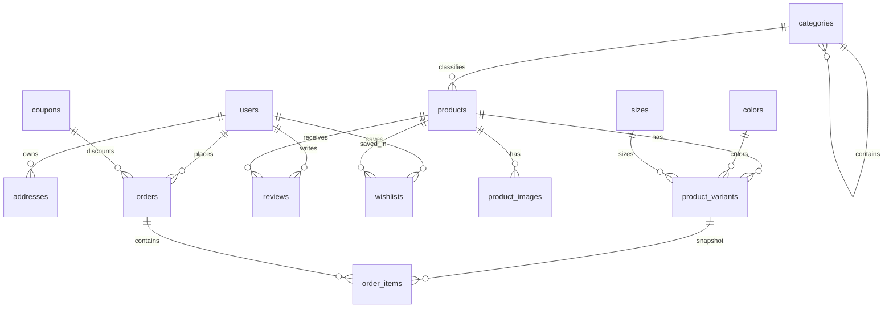

# 02 — Thiết kế cơ sở dữ liệu MySQL

Ứng dụng dùng MySQL qua `mysql2/promise` trong `lib/db.ts`. Schema dùng InnoDB, `utf8mb4`, UUID dạng `CHAR(36)` để tương thích với `randomUUID()` của Node.js, và `DATETIME` cho mốc thời gian.

## Cài đặt database mới

Yêu cầu MySQL 8.0.16 trở lên hoặc MariaDB 10.3 trở lên để thực thi đầy đủ các `CHECK` constraints. Tạo database bằng MySQL client hoặc phpMyAdmin:

```sql
CREATE DATABASE moc_studio
  CHARACTER SET utf8mb4
  COLLATE utf8mb4_unicode_ci;

CREATE USER 'moc_studio'@'localhost' IDENTIFIED BY 'replace-with-a-strong-password';
GRANT SELECT, INSERT, UPDATE, DELETE ON moc_studio.* TO 'moc_studio'@'localhost';
```

Run the schema and migrations with a database owner account; use the restricted `moc_studio` account for the application.

Chọn `moc_studio`, rồi chạy các file SQL đúng thứ tự, mỗi file một lần:

1. `scripts/001_create_schema.sql` — tạo bảng và dữ liệu danh mục/màu/size cơ bản.
2. `scripts/002_add_children_category.sql` — thêm danh mục Trẻ em.
3. `scripts/003_add_product_type.sql` — thêm và phân loại `product_type`.
4. `scripts/004_refine_accessory_product_types.sql` — phân loại chi tiết phụ kiện.
5. `scripts/005_make_address_district_optional.sql` — cho phép bỏ cấp quận/huyện.
6. `scripts/006_add_product_is_new.sql` — thêm cờ sản phẩm mới.
7. `scripts/007_reduce_product_prices.sql` — giảm giá gốc, giá khuyến mãi và giá ghi đè của biến thể xuống 1/10; giữ nguyên giá các đơn đã đặt.
8. `scripts/008_allow_sepay_payment_method.sql` — mở rộng cột phương thức thanh toán cho SePay.
9. `scripts/009_validate_integrity.sql` — kiểm tra dữ liệu cũ trước khi bật ràng buộc mới; xử lý các dòng vi phạm để mọi bộ đếm bằng 0.
10. `scripts/010_enforce_integrity.sql` — thêm CHECK, khóa duy nhất và quan hệ màu sắc sản phẩm bằng khóa ngoại.
11. `scripts/011_add_user_active_status.sql` — thêm cờ khóa tài khoản; tài khoản cũ mặc định vẫn hoạt động.
12. `scripts/012_mysql57_integrity_triggers.sql` — phương án tương thích MySQL 5.7 để chặn dữ liệu sai theo từng dòng bằng trigger; chỉ dùng khi không thể nâng cấp máy chủ.
13. `scripts/013_add_review_visibility.sql` — thêm trạng thái hiển thị để quản trị viên duyệt/ẩn đánh giá.
14. `scripts/014_create_store_settings.sql` — tạo bảng cài đặt cửa hàng và các giá trị cấu hình ban đầu.
15. `scripts/015_admin_operations.sql` — thêm phản hồi quản trị viên cho đánh giá, lịch sử điều chỉnh kho và nhật ký thao tác quản trị.

Không chạy các migration `002`–`006`, `008`, `010`, `011` hoặc `012` lặp lại trên cùng database. Chúng là migration một lần, không tự ghi nhận lịch sử đã chạy. Migration `007` tự ghi nhận trong `schema_migrations` và có thể chạy lại an toàn. Chạy migration `009` trước `010` hoặc `012`; nếu dữ liệu hiện có vi phạm, xử lý các dòng đó rồi chạy lại bước kiểm tra. Dùng `010` trên MySQL 8.0.16+/MariaDB 10.3+. Với MySQL 5.7, dùng `009`, `011` nếu thiếu `users.is_active`, rồi `012` (bỏ qua `010`). Nâng cấp máy chủ vẫn là lựa chọn được khuyến nghị để có `CHECK` native.

Chạy migration `015` sau `013` và `014`. Các migration `013`–`015` cũng là migration một lần.

Các trang quản trị, server actions và API tải ảnh kiểm tra lại `role` cùng `is_active` trong database ở mỗi request quản trị. Để khóa tài khoản, đặt `users.is_active = 0`; đặt lại `1` để mở khóa. Các session admin hiện có mất quyền ngay khi thay đổi này được commit.

Tạo `.env.local` từ `.env.example`, đặt tài khoản MySQL có quyền tối thiểu trên database này và tạo `SESSION_SECRET` ngẫu nhiên dài ít nhất 32 ký tự. Không dùng tài khoản `root` trong môi trường triển khai.

Để tạo tài khoản quản trị, khai báo `ADMIN_EMAIL` và `ADMIN_PASSWORD` (ít nhất 12 ký tự) trong `.env.local`, sau đó chạy:

```sh
pnpm exec tsx scripts/create-admin.ts
```

## Bảng dữ liệu



- `users`, `addresses`: tài khoản, thông tin giao hàng đã lưu.
- `categories`: danh mục phân cấp; `products`: sản phẩm và trạng thái bán.
- `colors`, `sizes`, `product_variants`: tổ hợp SKU và tồn kho.
- `product_images`: ảnh sản phẩm, có thể gắn màu.
- `orders`, `order_items`: đơn hàng và snapshot tên/màu/size/giá tại thời điểm mua.
- `coupons`, `reviews`, `wishlists`: bảng phục vụ các chức năng tương ứng.
- `carts`, `cart_items`: cấu trúc giỏ hàng trong database; giỏ hiện tại phía cửa hàng còn được giữ ở client.

Giá lưu bằng số nguyên VND. UUID lưu thành chuỗi 36 ký tự. Các `CHECK` constraints được bật trong migration `010`; production preflight kiểm tra phiên bản máy chủ và các constraint bắt buộc. Tổng đơn so với tổng các dòng hàng, giới hạn coupon đồng thời và đồng bộ tồn kho vẫn cần transaction ở server vì đây là quy tắc tổng hợp nhiều dòng/bảng.

## Database cũ

Không chạy schema MySQL trên PostgreSQL hoặc ngược lại. Chuyển dữ liệu từ một database PostgreSQL cũ cần quy trình export, ánh xạ kiểu dữ liệu và import riêng; các script ở đây chỉ tạo/cập nhật schema MySQL.
