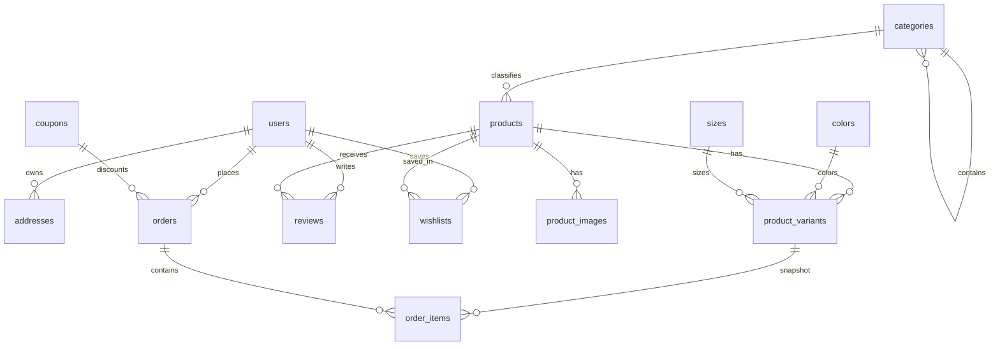

# 02 — Thiết kế cơ sở dữ liệu MySQL

Ứng dụng dùng MySQL qua `mysql2/promise` trong `lib/db.ts`. Schema dùng InnoDB, `utf8mb4`, UUID dạng `CHAR(36)` để tương thích với `randomUUID()` của Node.js, và `DATETIME` cho mốc thời gian.

## Cài đặt database mới

Yêu cầu MySQL 5.7 trở lên. Tạo database bằng MySQL client hoặc phpMyAdmin:

```sql
CREATE DATABASE moc_studio
  CHARACTER SET utf8mb4
  COLLATE utf8mb4_unicode_ci;

CREATE USER 'moc_studio'@'localhost' IDENTIFIED BY 'replace-with-a-strong-password';
GRANT SELECT, INSERT, UPDATE, DELETE ON moc_studio.* TO 'moc_studio'@'localhost';
```

Run the schema and migrations with a database owner account; use the restricted `moc_studio` account for the application.

Chọn `moc_studio`, rồi chạy các file SQL đúng thứ tự, mỗi file một lần:

1. `scripts/001_create_schema.sql` — tạo bảng và dữ liệu danh mục/màu/size cơ bản.
2. `scripts/002_add_children_category.sql` — thêm danh mục Trẻ em.
3. `scripts/003_add_product_type.sql` — thêm và phân loại `product_type`.
4. `scripts/004_refine_accessory_product_types.sql` — phân loại chi tiết phụ kiện.
5. `scripts/005_make_address_district_optional.sql` — cho phép bỏ cấp quận/huyện.
6. `scripts/006_add_product_is_new.sql` — thêm cờ sản phẩm mới.

Không chạy các migration `002`–`006` lặp lại trên cùng database. Chúng là migration một lần, không tự ghi nhận lịch sử đã chạy.

Tạo `.env.local` từ `.env.example`, đặt tài khoản MySQL có quyền tối thiểu trên database này và tạo `SESSION_SECRET` ngẫu nhiên dài ít nhất 32 ký tự. Không dùng tài khoản `root` trong môi trường triển khai.

Để tạo tài khoản quản trị, khai báo `ADMIN_EMAIL` và `ADMIN_PASSWORD` (ít nhất 12 ký tự) trong `.env.local`, sau đó chạy:

```sh
pnpm exec tsx scripts/create-admin.ts
```

## Bảng dữ liệu



- `users`, `addresses`: tài khoản, thông tin giao hàng đã lưu.
- `categories`: danh mục phân cấp; `products`: sản phẩm và trạng thái bán.
- `colors`, `sizes`, `product_variants`: tổ hợp SKU và tồn kho.
- `product_images`: ảnh sản phẩm, có thể gắn màu.
- `orders`, `order_items`: đơn hàng và snapshot tên/màu/size/giá tại thời điểm mua.
- `coupons`, `reviews`, `wishlists`: bảng phục vụ các chức năng tương ứng.
- `carts`, `cart_items`: cấu trúc giỏ hàng trong database; giỏ hiện tại phía cửa hàng còn được giữ ở client.

Giá lưu bằng số nguyên VND. UUID lưu thành chuỗi 36 ký tự. MySQL 5.7 không thực thi `CHECK` constraints, vì vậy các giới hạn giá, số lượng và trạng thái cần được kiểm tra ở server như các server action hiện tại.

## Database cũ

Không chạy schema MySQL trên PostgreSQL hoặc ngược lại. Chuyển dữ liệu từ một database PostgreSQL cũ cần quy trình export, ánh xạ kiểu dữ liệu và import riêng; các script ở đây chỉ tạo/cập nhật schema MySQL.
